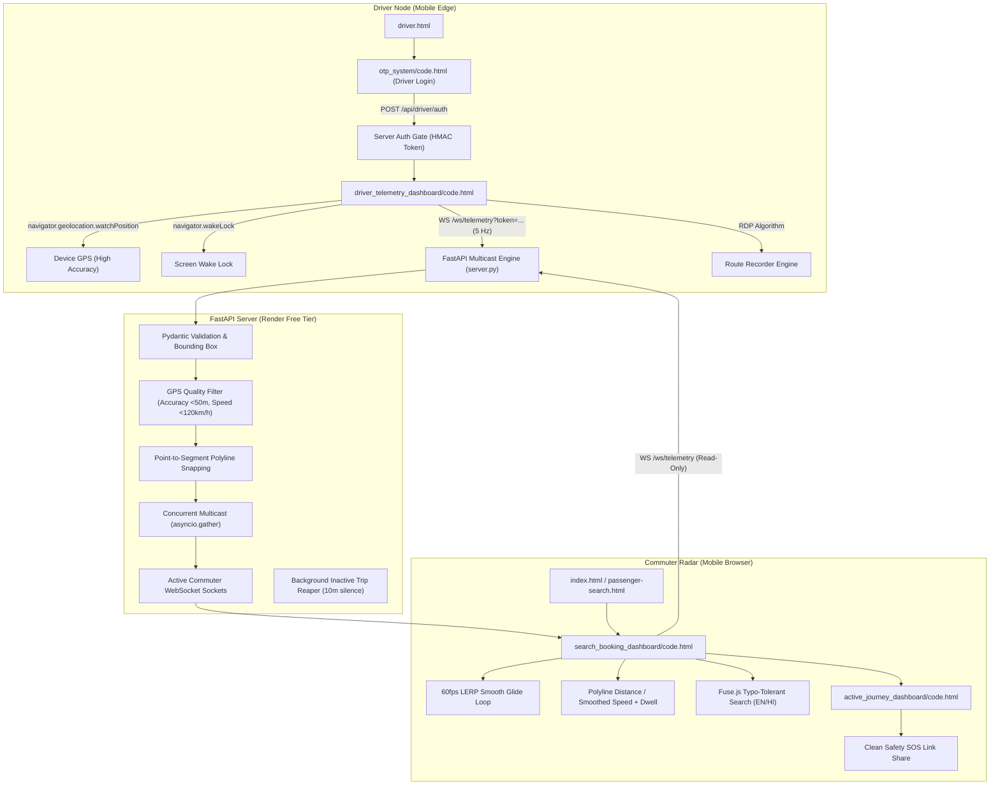

# 🚍 BusRadar — Master Technical Architecture & Specification Document
> **Team LogiCode | Real-Time Public Transport Tracking System (Release v2.0)**  
> **Corridor:** Yamuna Nagar Bus Stand ⇄ MMDU Mullana Campus Gate (Haryana State Highway 4 & NH-344)  
> **Architecture Archetype:** Zero-Hardware Edge-Assisted Telemetry, Geospatial Multicast & Municipal Transit Analytics

---

## 1. Executive Summary & Problem Statement

### Problem Statement
Public transit across Tier-2/3 Indian cities and suburban university corridors lacks real-time visibility. Traditional automated vehicle location (AVL) systems require expensive AIS-140 GPS transponders (₹15,000–₹30,000 per bus) plus ongoing SIM data contracts, making fleet-wide instrumentation prohibitive for municipal and private operators. Consequently, passengers endure long wait times with no ETA certainty, and transit operators have no real-time telemetry on route congestion or service delays.

### The BusRadar Solution
**BusRadar** is a **zero-hardware-cost, zero-API-key transit tracking web platform**:
1. **Real-Device Driver Telemetry:** Drivers open a web console on any mobile device (Android/iOS) and stream raw GPS updates (`navigator.geolocation.watchPosition` with `enableHighAccuracy: true`) over a WebSocket channel.
2. **Frictionless Commuter Experience:** Passengers track approaching buses on an interactive Leaflet map with real road-following ETAs directly in their mobile browser—without installing an app or registering.
3. **Map-Matching & Precision Filters:** Pure mathematical point-to-segment projection snaps vehicle positions to pre-recorded road polylines, discarding multipath GPS jitter and filtering bad fixes (>50m accuracy or >120 km/h velocity jumps).
4. **Zero-Cost Infrastructure:** Runs completely on Render's free tier with an external keep-alive pinger, ephemeral memory-only state, and zero third-party API dependencies.
5. **Driver Route Recording:** Drivers can drive a route once to record GPS coordinates, automatically simplified via the Ramer-Douglas-Peucker (RDP) algorithm, with JSON export and server persistence.
6. **Honest Stale-Data Status:** Displays true operational states: `LIVE (<10s ago)`, `WEAK SIGNAL (10-30s)`, `LAST SEEN N min ago`, and `TRIP COMPLETED`. Friendly empty states prevent fake ghost buses.

---

## 2. System Architecture & Component Interaction



---

## 3. Complete REST API & WebSocket Protocol Reference

### REST Endpoints (`server.py`)

#### 1. `GET /api/health`
Lightweight health endpoint designed for external keep-alive pingers (cron-job.org).
* **Sample Response:**
```json
{
  "status": "healthy",
  "service": "BusRadar-Engine",
  "version": "2.0.0",
  "uptime_seconds": 1245.8,
  "active_trips_count": 1,
  "active_connections": 12,
  "timestamp": 1700000000.0,
  "free_tier_ready": true
}
```

#### 2. `POST /api/driver/auth`
Validates driver credentials against server-side PIN hashes with a strict 5-attempt rate-limit lockout.
* **Request:**
```json
{
  "bus_id": "HR-02-A-1001",
  "pin": "1001",
  "phone": "9876543210"
}
```
* **Success Response (200 OK):**
```json
{
  "status": "authenticated",
  "token": "4f8a3...signed_hmac_sha256_token",
  "bus_id": "HR-02-A-1001",
  "route_id": "ynr_mmdu_sh4",
  "route_name": "Yamuna Nagar Stand ⇄ MMDU Campus Gate",
  "expires_in": 43200
}
```
* **Lockout Response (429 Too Many Requests):**
```json
{
  "error": "Too many failed attempts. Driver access locked for 15 minutes."
}
```

#### 3. `GET /api/fleet`
Returns current live trips actively broadcasting on the road.
```json
{
  "fleet": [
    {
      "bus_id": "HR-02-A-1001",
      "route_name": "Yamuna Nagar Stand ⇄ MMDU Campus Gate",
      "lat": 30.1650,
      "lng": 77.2600,
      "speed_kmh": 42.0,
      "delay_minutes": 5,
      "delay_reason": "Heavy Traffic",
      "status": "LIVE",
      "status_label": "LIVE",
      "age_seconds": 1.2
    }
  ],
  "total_active": 1
}
```

#### 4. `GET /api/routes` & `GET /api/routes/{route_id}`
Retrieves corridor geometries, verified stops, and dense highway polylines.

#### 5. `POST /api/routes/save`
Allows authorized drivers (with session token) or admins (with `X-Admin-Passcode`) to persist recorded polylines with automated RDP compression.

---

### WebSocket Protocol (`/ws/telemetry`)

* **URL:** `ws://domain/ws/telemetry?token={driver_token}&bus_id={bus_id}`
* **Role Enforcement:**
  * **Driver:** Connected with valid HMAC token. Granted publisher rights for their assigned bus.
  * **Passenger:** Connected without token. Read-only subscriber. Any publication attempt triggers immediate `WS_1008_POLICY_VIOLATION` disconnect.

#### Incoming Driver Packet: `DRIVER_TELEMETRY`
```json
{
  "event_type": "DRIVER_TELEMETRY",
  "bus_id": "HR-02-A-1001",
  "lat": 30.1435,
  "lng": 77.2880,
  "accuracy": 8.5,
  "speed_kmh": 45.0,
  "heading": 85.0,
  "sequence_number": 42,
  "client_timestamp": 1700000000000
}
```

#### Incoming Driver Packet: `DRIVER_DELAY`
```json
{
  "event_type": "DRIVER_DELAY",
  "bus_id": "HR-02-A-1001",
  "delay_minutes": 10,
  "reason": "Route Detour"
}
```

#### Server Multicast Packet (To All Commuters)
```json
{
  "event_type": "DRIVER_TELEMETRY",
  "bus_id": "HR-02-A-1001",
  "lat": 30.14352,
  "lng": 77.28804,
  "speed_kmh": 45.0,
  "accuracy": 8.5,
  "delay_minutes": 10,
  "delay_reason": "Route Detour",
  "sequence_number": 42,
  "server_timestamp": 1700000000.125
}
```

---

## 4. Mathematical Algorithms

### 1. Haversine Distance
$$d = 2R \arcsin\left(\sqrt{\sin^2\left(\frac{\Delta\phi}{2}\right) + \cos\phi_1\cos\phi_2\sin^2\left(\frac{\Delta\lambda}{2}\right)}\right)$$
Where $R = 6,371,000\text{ meters}$.

### 2. Point-to-Segment Snapping
Given road segment vertices $A$ and $B$, and raw GPS point $P$:
$$t = \max\left(0, \min\left(1, \frac{(P - A) \cdot (B - A)}{\|B - A\|^2}\right)\right)$$
Projected coordinate on road:
$$P' = A + t(B - A)$$

### 3. Ramer-Douglas-Peucker (RDP) Polyline Simplification
Given coordinate sequence $S = \{p_1, \dots, p_n\}$ and epsilon $\varepsilon = 0.00005^\circ$:
Finds node with maximum perpendicular distance $d_{\max}$ to line chord $(p_1, p_n)$. If $d_{\max} > \varepsilon$, splits recursively. Compresses dense GPS traces by 75–85% while preserving highway curvature.

### 4. Road-Following ETA Equation
$$\text{ETA (mins)} = \left(\frac{d_{\text{poly\_remaining}}}{v_{\text{smooth}}}\right) \times 60 + (N_{\text{stops}} \times 0.75) + \text{delay}_{\text{reported}}$$
Where:
* $d_{\text{poly\_remaining}}$ is cumulative distance along polyline segments to destination.
* $v_{\text{smooth}} = 0.2 \cdot v_{\text{current}} + 0.8 \cdot v_{\text{smooth}}$, clamped to $[15\text{ km/h}, 80\text{ km/h}]$.
* $N_{\text{stops}} \times 0.75$ represents 45-second passenger dwell allowance per intermediate stop.
* $\text{delay}_{\text{reported}}$ is transit delay broadcast by the driver.

---

## 5. Security, Privacy & Compliance

1. **Zero Location Persistence:** Raw coordinates are processed strictly in volatile RAM. No database, GPX, or KML files are written to disk.
2. **10-Minute Silence Auto-Cleanup:** If a driver loses connection or forgets to end a trip, a background asyncio reaper automatically clears the trip state after 600 seconds of silence.
3. **Cryptographic Tokens:** Driver tokens are signed using HMAC-SHA256 with timestamp and unique salt.
4. **Input Neutralization:** All string inputs are escaped via `html.escape()` to prevent Cross-Site Scripting (XSS).
5. **Rate Limiting:** REST APIs are protected via `slowapi` (60–120 req/min/IP). WebSocket clients are limited to 5 msgs/sec and 4KB payload size.

---

## 6. Automated Testing Verification (31/31 Tests Passed)

All 31 automated tests executed and verified:
* **Authentication Suite (4 tests):** Valid PIN, invalid PIN rejection, 5-attempt lockout, admin bus registration.
* **Geospatial & Telemetry Suite (7 tests):** Coordinate bounding boxes, impossible velocity jump rejection, accuracy filtering (>50m drop), XSS neutralization, delay validation, Haversine accuracy, polyline snapping.
* **WebSocket Engine Suite (7 tests):** Read-only passenger enforcement, token validation, authorized driver multicast broadcast, ping/pong heartbeat, bad accuracy drop, oversized packet drop.
* **Simulation Guard Suite (4 tests):** Default server simulation disabled (`SIMULATION_ENABLED=false`), fleet starts empty with 0 active trips, passenger WebSocket snapshot contains 0 ghost buses, static frontend audit proves zero unattended simulation loops on page load.
* **High Concurrency Benchmark:** 500 packets across 100 concurrent subscribers completed in **9.67 ms** (51,696 msgs/sec throughput, +0.19 MB memory delta).

*(Detailed test execution matrix available in [TEST_REPORT.md](TEST_REPORT.md))*

---

## 7. Real-Only Telemetry Architecture & Simulation Gating

To guarantee academic and operational integrity:
1. **Default Live Mode:** The bus marker moves **exclusively** when real GPS telemetry arrives from an authenticated driver's smartphone via `navigator.geolocation.watchPosition` (`enableHighAccuracy: true`).
2. **Empty State on Load:** When no driver is broadcasting, the passenger map displays `WAITING FOR DRIVER` / `Waiting for live GPS`. No ghost bus appears, and no coordinates move.
3. **Simulation Gating:** Any demo/indoor simulation is **OFF by default** on page load. It requires explicit user activation via a dedicated button (`[Demo Simulation]`), prompts a confirmation dialog, and displays a persistent high-visibility purple warning banner: `⚠️ SIMULATION MODE ACTIVE (NOT REAL GPS)` on all screens.

---
*© Team LogiCode | Smart India Hackathon (SIH 2024 / SIH26205) | Production v2.0*
