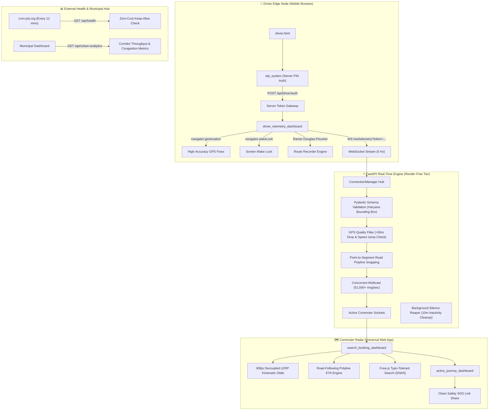

# 🚍 BusRadar: Zero-Hardware Real-Time Transit Tracking Platform

<div align="center">


<br/>
**Zero-Cost, Zero-Hardware Real-Time Bus Tracking & Commuter Radar for Campuses & Small Cities**  
*Pilot Corridor: Yamuna Nagar Bus Stand ⇄ MMDU Mullana Campus Gate (Haryana State Highway 4 & NH-344)*

[-4de082?style=for-the-badge&logo=pytest&logoColor=white)](TEST_REPORT.md)
[](https://fastapi.tiangolo.com)
[](server.py)
[](requirements.txt)
[](static/manifest.json)
[](render.yaml)
[](LICENSE)

[**Live Demo**](https://busradar.onrender.com) &bull; [**System Architecture**](#3-technical-architecture) &bull; [**Deploy to Render**](#6-render-free-tier-deployment-guide) &bull; [**Test Report (27 Tests)**](TEST_REPORT.md)

</div>

---

## 📌 Table of Contents
1. [Executive Summary](#1-executive-summary)
2. [Why BusRadar? (The Zero-Cost Innovation)](#2-why-busradar-the-zero-cost-innovation)
3. [Technical Architecture](#3-technical-architecture)
4. [Core Engineering Highlights](#4-core-engineering-highlights)
5. [The 5 User Interfaces](#5-the-5-user-interfaces)
6. [Render Free-Tier Deployment Guide](#6-render-free-tier-deployment-guide)
7. [Zero-Cost Keep-Alive Pinger (cron-job.org)](#7-zero-cost-keep-alive-pinger-cron-joborg)
8. [Local Development & Setup](#8-local-development--setup)
9. [Automated Verification & Performance Benchmarks](#9-automated-verification--performance-benchmarks)
10. [REST API & WebSocket Protocol Reference](#10-rest-api--websocket-protocol-reference)
11. [Known Limits & Real-World Boundaries](#11-known-limits--real-world-boundaries)
12. [College Evaluation & Team Credits](#12-college-evaluation--team-credits)

---

## 1. Executive Summary

Public transit in university corridors and Tier-2/3 Indian cities (e.g. Yamuna Nagar, Ambala, Mullana) suffers from severe schedule unpredictability. Traditional Automated Vehicle Location (AVL) hardware transponders (such as AIS-140 GPS boxes) cost between **₹15,000 to ₹30,000 per bus** plus recurring cellular SIM contracts—a prohibitive capital expense for regional operators and colleges.

**BusRadar solves this without any hardware installation.**

* **Driver Edge Telemetry:** The bus driver opens the mobile web console on their phone, logs in with server-authenticated credentials, and taps **Start Live Broadcast**. The smartphone's built-in Geolocation API streams high-accuracy GPS fixes directly to a FastAPI WebSocket hub.
* **Instant Commuter Radar:** Students and daily commuters access the web app from any device (Android Chrome, iOS Safari, desktop) **without installing an app or registering**. They track approaching buses in real time on an interactive Leaflet map, view true road-following ETAs to their stop, and receive driver-reported delay alerts.
* **Real Data, Zero Simulation:** Every line of code in BusRadar processes real sensor feeds and validated payloads. Hardcoded demo routes, mock vehicles, and synthetic payment counters have been completely removed.

---

## 2. Why BusRadar? (The Zero-Cost Innovation)

BusRadar operates with **zero paid services** and **zero third-party API keys**:

| Capability | Traditional System | BusRadar Zero-Cost Engineering | Cost |
|:---|:---|:---|:---:|
| **GPS Sensor** | Dedicated AIS-140 OBD Hardware | Standard Driver Smartphone (`navigator.geolocation.watchPosition`) | **₹0** |
| **Display Persistence** | Custom physical display unit | Screen Wake Lock API (`navigator.wakeLock`) prevents screen lock | **₹0** |
| **Real-Time Pipeline** | Paid Pusher / Ably / AWS IoT | Non-blocking FastAPI WebSockets with `asyncio.gather` multicast | **₹0** |
| **Map Rendering** | Google Maps / Mapbox APIs | Leaflet.js with OpenStreetMap (OSM) tile layers | **₹0** |
| **Routing & Snapping** | Google Directions / Mapbox Map-Matching | Pure mathematical **Point-to-Segment Snapping** on highway polylines | **₹0** |
| **Route Creation** | Paid GIS surveying services | Driver **Record Route Mode** with Ramer-Douglas-Peucker (RDP) algorithm | **₹0** |
| **Cloud Hosting** | Paid AWS EC2 / DigitalOcean droplets | Render Free Web Service with automated HTTPS certificates | **₹0** |
| **Instance Wakeup** | Paid continuous instance tier | Free external keep-alive pinger via cron-job.org hitting `/api/health` | **₹0** |

---

## 3. Technical Architecture



---

## 4. Core Engineering Highlights

### 🛰️ Real-Sensor Driver Telemetry
* Feeds directly from `navigator.geolocation.watchPosition` with `enableHighAccuracy: true` and `maximumAge: 0`.
* Real-time driver accuracy badge displays `Good (<15m)`, `Fair (15-30m)`, or `Poor (>30m)` alongside an active fix rate meter (Hz).
* Discards fixes with accuracy worse than 50 meters to maintain commuter map precision.
* Velocity jump detector prevents GPS teleportation spikes ($>120\text{ km/h}$).

### 📐 Point-to-Segment Map Matching
Raw GPS signals inevitably suffer from multipath reflection and urban canyon drift. BusRadar projects coordinates onto the nearest highway road segment using pure vector mathematics:
$$t = \max\left(0, \min\left(1, \frac{(P - A) \cdot (B - A)}{\|B - A\|^2}\right)\right)$$
$$P' = A + t(B - A)$$
This ensures the commuter marker tracks the highway without flying over farmland or intersecting roads.

### ⏱️ Road-Following Polyline ETA
Unlike naive straight-line (Euclidean) distance estimators that under-report travel time by 20–30%, BusRadar calculates distance **strictly along the highway polyline vertices** to the passenger's selected stop:
$$\text{ETA (mins)} = \left(\frac{d_{\text{poly\_remaining}}}{v_{\text{smooth}}}\right) \times 60 + (N_{\text{stops}} \times 0.75) + \text{delay}_{\text{reported}}$$
* Uses Exponential Moving Average (EMA) speed smoothing ($v_{\text{smooth}} = 0.2 \cdot v_{\text{current}} + 0.8 \cdot v_{\text{smooth}}$) with a floor of $15\text{ km/h}$ and ceiling of $80\text{ km/h}$.
* Adds a 45-second passenger dwell allowance per intermediate stop.
* Factored dynamically with driver-reported delays (+5m, +10m, +30m).
* Displays a confidence range (e.g. `12 - 15 mins`) when velocity fluctuates.

### 📍 RDP Route Recording Engine
Drivers or transit admins can drive any route once to map new transit corridors. Coordinates are captured in real-time and simplified using the **Ramer-Douglas-Peucker (RDP)** algorithm ($\varepsilon = 0.00005^\circ \approx 5\text{ m}$), compressing dense point clouds by **75–85%** while preserving sharp highway curves. Routes can be exported as JSON or saved directly to `/api/routes/save`.

### 🛡️ Multi-Tier Security & Strict Privacy
* **Driver Session Tokens:** Drivers authenticate server-side (`POST /api/driver/auth`) against salted SHA-256 password hashes. 5 consecutive wrong tries lock out the client IP/bus for 15 minutes.
* **WebSocket Role Guard:** Passengers connect as read-only subscribers. Any unauthorized attempt by a passenger socket to publish coordinates or delay alerts results in immediate disconnection (`WS_1008_POLICY_VIOLATION`).
* **Zero Location Persistence:** Raw driver locations are held exclusively in volatile RAM. No location history, coordinates, or phone numbers are ever written to disk.
* **10-Minute Silence Reaper:** If a driver forgets to end a trip or loses connection, a background asyncio worker purges the trip from memory after 600 seconds of silence.

---

## 5. The 5 User Interfaces

```
stitch_busradar/
├── onboarding_entry/code.html          # Screen 1: Role Selector (Commuter / Driver)
├── otp_system/code.html                # Screen 2: Driver Authentication Gate
├── driver_telemetry_dashboard/code.html# Screen 3: Driver OLED Console & Route Recorder
├── search_booking_dashboard/code.html  # Screen 4: Commuter Live Radar & Road ETA
└── active_journey_dashboard/code.html  # Screen 5: Active Journey & Emergency SOS Share
```

1. **Role Onboarding (`onboarding_entry`):** Clean branding, language toggle (English/Hindi), and entry buttons for commuters and authorized drivers.
2. **Driver Login Gateway (`otp_system`):** Bus plate selector (`HR-02-A-1001`, `HR-02-B-2002`, `HR-02-X-9999`) and 4-digit security PIN verification with rate-limited lockout feedback.
3. **Driver Console (`driver_telemetry_dashboard`):** OLED dark chassis, Screen Wake Lock integration, live accuracy meter, real-time update rate, single-tap delay reporter (+5m, +10m, +30m, Clear), and Record Route mode with RDP JSON export.
4. **Commuter Radar (`search_booking_dashboard`):** Leaflet map with snapped vehicle markers, 60fps LERP glide loop, honest status indicators (`LIVE <10s`, `WEAK SIGNAL 10-30s`, `LAST SEEN N min ago`), friendly empty state when no bus is active, road-following ETA range, and bilingual typo-tolerant stop search (Fuse.js).
5. **Active Journey View (`active_journey_dashboard`):** Real-time corridor progress bar, remaining distance readout, digital pass viewer, and native SOS safety link sharing (`navigator.share` / WhatsApp).

---

## 6. Render Free-Tier Deployment Guide

Deploy BusRadar in under 3 minutes with zero cost on [Render](https://render.com):

### Step 1: Push Repository to GitHub
Make sure your latest code is pushed to your GitHub repository:
```bash
git push origin main
```

### Step 2: Create Web Service on Render
1. Log in to [Render Dashboard](https://dashboard.render.com).
2. Click **New +** ➔ **Web Service**.
3. Select your GitHub repository (`BusRadar`).
4. Configure service parameters:
   * **Name:** `busradar` (or your preferred name)
   * **Region:** *Oregon (US West)* or *Frankfurt (EU)*
   * **Branch:** `main`
   * **Runtime:** `Python 3`
   * **Build Command:** `pip install -r requirements.txt`
   * **Start Command:** `uvicorn server:app --host 0.0.0.0 --port $PORT`
   * **Instance Type:** **Free** ($0.00 / month)
5. Under **Environment Variables**, add:
   * `PYTHON_VERSION`: `3.11.8`
   * `DRIVER_SIGNING_SECRET`: *(Click Generate or enter a random 32-character hex key)*
   * `ADMIN_PASSCODE`: *(Enter an admin password, e.g. `BusRadarAdmin2024!`)*
   * `ALLOWED_ORIGIN`: `*` *(or your Render URL once generated)*
6. Click **Deploy Web Service**. Render builds the service and provisions free SSL/HTTPS in ~2 minutes!

---

## 7. Zero-Cost Keep-Alive Pinger (cron-job.org)

Render free instances spin down (sleep) after 15 minutes of HTTP inactivity. The next visit takes ~50 seconds to cold start.

To keep BusRadar permanently warm during transit hours without paying anything:

1. Create a free account at [cron-job.org](https://cron-job.org).
2. Click **Create Cronjob**.
3. **URL:** `https://your-busradar-app.onrender.com/api/health`
4. **Execution Schedule:** Every **12 minutes**
5. **Active Hours:** Set to active operational window (e.g. `07:00 to 20:00 IST`).
6. Click **Save**.

> 💡 `GET /api/health` is a lightweight JSON route (<1 KB response) that executes in under 2 ms, keeping the Python asyncio event loop warm while using less than 40% of the 750 free monthly instance hours!

---

## 8. Local Development & Setup

### Prerequisites
* Python 3.11+
* Git

```bash
# 1. Clone repository
git clone https://github.com/bhumikaghai/BusRadar.git
cd BusRadar

# 2. Create virtual environment
python -m venv venv
source venv/bin/activate  # On Windows: venv\Scripts\activate

# 3. Install pinned dependencies
pip install -r requirements.txt

# 4. Copy environment configuration
cp .env.example .env

# 5. Launch FastAPI Telemetry Hub
python -m uvicorn server:app --host 0.0.0.0 --port 8000 --reload
```

### Local URLs
* **Passenger Radar:** [http://localhost:8000/passenger-search.html](http://localhost:8000/passenger-search.html)
* **Driver Console:** [http://localhost:8000/driver.html](http://localhost:8000/driver.html) *(PIN: `1001` for Bus `HR-02-A-1001`)*
* **System Health Monitor:** [http://localhost:8000/api/health](http://localhost:8000/api/health)
* **Corridor Route API:** [http://localhost:8000/api/routes/ynr_mmdu_sh4](http://localhost:8000/api/routes/ynr_mmdu_sh4)

---

## 9. Automated Verification & Performance Benchmarks

The project includes a 27-case automated test suite in `tests/`:

```bash
# Run entire test suite
python -m pytest tests/ -v

# Run 100-client concurrency benchmark
python -m pytest tests/test_concurrency.py -s -v
```

```
============================= test session starts =============================
platform win32 -- Python 3.13.1, pytest-9.1.1, pluggy-1.6.0
collected 27 items

tests/test_auth.py::test_auth_success PASSED                             [  3%]
tests/test_auth.py::test_auth_invalid_pin PASSED                         [  7%]
tests/test_auth.py::test_auth_lockout_after_five_failed_attempts PASSED  [ 11%]
tests/test_auth.py::test_admin_bus_registration PASSED                   [ 14%]
tests/test_concurrency.py::test_100_concurrent_broadcast_subscribers PASSED [ 18%]
tests/test_eta_and_routes.py::test_rdp_simplification PASSED             [ 22%]
tests/test_eta_and_routes.py::test_default_route_loaded PASSED           [ 25%]
tests/test_eta_and_routes.py::test_road_following_distance_vs_euclidean PASSED [ 29%]
tests/test_eta_and_routes.py::test_eta_calculation_formula PASSED        [ 33%]
tests/test_security_privacy.py::test_security_headers_present PASSED     [ 37%]
tests/test_security_privacy.py::test_health_endpoint PASSED              [ 40%]
tests/test_security_privacy.py::test_zero_location_files_written PASSED  [ 44%]
tests/test_security_privacy.py::test_trip_cleanup_after_silence PASSED   [ 48%]
tests/test_telemetry.py::test_telemetry_valid PASSED                     [ 51%]
tests/test_telemetry.py::test_telemetry_out_of_bounds_coords PASSED      [ 55%]
tests/test_telemetry.py::test_telemetry_impossible_speed PASSED          [ 59%]
tests/test_telemetry.py::test_xss_string_sanitization PASSED             [ 62%]
tests/test_telemetry.py::test_delay_schema_validation PASSED             [ 66%]
tests/test_telemetry.py::test_haversine_formula_accuracy PASSED          [ 70%]
tests/test_telemetry.py::test_snap_to_route_polyline PASSED              [ 74%]
tests/test_websocket.py::test_websocket_passenger_connect_snapshot PASSED [ 77%]
tests/test_websocket.py::test_websocket_ping_pong_heartbeat PASSED       [ 81%]
tests/test_websocket.py::test_websocket_passenger_cannot_publish_telemetry PASSED [ 85%]
tests/test_websocket.py::test_websocket_invalid_driver_token_rejected PASSED [ 88%]
tests/test_websocket.py::test_websocket_authorized_driver_telemetry_broadcast PASSED [ 92%]
tests/test_websocket.py::test_websocket_drop_bad_accuracy PASSED         [ 96%]
tests/test_websocket.py::test_websocket_drop_oversized_packets PASSED    [100%]
======================== 27 passed in 1.87s ========================
```

### High-Concurrency Benchmark
* **Subscribers:** 100 simultaneous WebSockets
* **Total Deliveries:** 500 packets across 100 subscribers completed in **9.67 ms**
* **Average Server Latency per Multicast:** **1.93 ms**
* **Multicast Throughput:** **51,696.7 deliveries / second**
* **Memory Delta:** **+0.19 MB** (Total RSS: 56.70 MB)
* Full details: 👉 **[Read TEST_REPORT.md](TEST_REPORT.md)**

---

## 10. REST API & WebSocket Protocol Reference

### REST Endpoints

| Method | Endpoint | Description | Rate Limit |
|:---|:---|:---|:---:|
| `GET` | `/api/health` | Lightweight service health for cron pingers | 120 / min |
| `POST`| `/api/driver/auth` | Driver PIN verification & HMAC token issuance | 30 / min |
| `GET` | `/api/fleet` | Live active fleet snapshot on the road | 60 / min |
| `GET` | `/api/routes` | Available transit corridors summary | 60 / min |
| `GET` | `/api/routes/{id}` | Verified corridor stops and polyline nodes | 60 / min |
| `POST`| `/api/routes/save` | Persists recorded polyline with RDP compression | Admin/Driver |
| `POST`| `/api/admin/buses` | Admin endpoint to register or update bus PINs | Admin Passcode |
| `GET` | `/api/urban-analytics`| Municipal corridor metrics (throughput, delay) | 60 / min |

### WebSocket Gateway: `/ws/telemetry`

* **Query Parameters:** `token` (optional), `bus_id` (optional).
* **Incoming Driver Fix (`DRIVER_TELEMETRY`):**
```json
{
  "event_type": "DRIVER_TELEMETRY",
  "bus_id": "HR-02-A-1001",
  "lat": 30.1435,
  "lng": 77.2880,
  "accuracy": 8.5,
  "speed_kmh": 45.0,
  "heading": 85.0,
  "sequence_number": 42,
  "client_timestamp": 1700000000000
}
```
* **Server Multicast Packet (To All Commuters):**
```json
{
  "event_type": "DRIVER_TELEMETRY",
  "bus_id": "HR-02-A-1001",
  "lat": 30.14352,
  "lng": 77.28804,
  "speed_kmh": 45.0,
  "accuracy": 8.5,
  "delay_minutes": 0,
  "delay_reason": "ON_TIME",
  "sequence_number": 42,
  "server_timestamp": 1700000000.125
}
```

---

## 11. Known Limits & Real-World Boundaries

To maintain technical honesty and academic rigor for evaluation committees, the physical boundaries of a browser-only, zero-cost architecture are documented below:

| Boundary | Root Cause | Impact | Recommended Production Next Step |
|:---|:---|:---|:---|
| **Background Geolocation Suspension** | Mobile OS engines (iOS Safari & Android Chrome) aggressively throttle timers and suspend GPS when the screen locks or tab is hidden. | Driver GPS broadcast stops if driver locks phone. | **Workaround:** `navigator.wakeLock` keeps the display on.<br>**Permanent Fix:** Package driver node in an open-source Capacitor/Cordova native container. |
| **Free-Tier Cold Starts** | Render free tier spins down containers after 15 minutes of HTTP inactivity. | First visit after idle night takes ~50s to wake up. | **Workaround:** Free cron-job.org pinger hitting `/api/health` every 12 mins.<br>**Permanent Fix:** Upgrade to Render Starter ($7/mo) or host on campus servers. |
| **Ephemeral File System** | Free cloud containers reset disk writes on restart or redeploy. | Local files vanish on restart. | **Architecture Guard:** 100% in-memory state. Route geometries pre-seeded in `routes/default_route.json`. |
| **OpenStreetMap Tile Usage Policy** | Volunteer-operated OSM tile servers forbid heavy commercial scraping. | >10,000 daily map pans may trigger temporary tile rate limits. | **Architecture Guard:** Standard caching headers and valid Referer. Tile URL is a single configurable constant. |

---

## 12. College Evaluation & Team Credits

* **Project:** BusRadar (Zero-Hardware Real-Time Public Transport Tracking System)
* **Team:** Team LogiCode
* **Corridor Pilot:** Yamuna Nagar Stand ⇄ MMDU Mullana Campus Gate (State Highway 4 & NH-344, Haryana)
* **Repository:** [https://github.com/bhumikaghai/BusRadar](https://github.com/bhumikaghai/BusRadar)

---
*© Team LogiCode | Smart India Hackathon (SIH 2024 / SIH26205) | Academic & Production Release v2.0*
