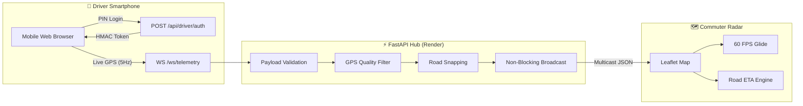

# 🚍 BusRadar

<div align="center">

**Zero-Hardware Real-Time Public Transit Tracking for Campuses & Regional Fleets**  
*Turning standard driver smartphones into high-precision transit transponders.*

[](https://fastapi.tiangolo.com)
[](server.py)
[](requirements.txt)
[](static/manifest.json)
[](https://busradar-bre5.onrender.com/)
[](LICENSE)

</div>

---

### 🌐 Live Deployment & Quick Access

| Portal | Direct Link | Access Details |
|:---|:---|:---|
| 🗺️ **Commuter Radar** | [**busradar-bre5.onrender.com/passenger-search.html**](https://busradar-bre5.onrender.com/passenger-search.html) | Live map tracking & road ETAs *(no install/login required)* |
| 📱 **Driver Console** | [**busradar-bre5.onrender.com/driver.html**](https://busradar-bre5.onrender.com/driver.html) | GPS broadcast console *(Bus: `HR-02-A-1001` \| PIN: `1001`)* |
| 🚪 **Main Onboarding** | [**busradar-bre5.onrender.com**](https://busradar-bre5.onrender.com/) | Role onboarding & language selection |
| 📑 **API Documentation**| [**busradar-bre5.onrender.com/docs**](https://busradar-bre5.onrender.com/docs) | Interactive Swagger UI API explorer |

---

## 📖 Overview

Dedicated transit GPS transponders (like AIS-140 units) cost **₹15,000–₹30,000 per bus** plus recurring cellular fees—a prohibitive expense for university campuses and regional routes.

**BusRadar** replaces hardware transponders with standard smartphone web browsers:
1. **Driver Edge Node:** An authorized driver logs in on any smartphone browser and taps **Start Live Broadcast**. The device streams GPS fixes over a WebSocket channel with Screen Wake Lock protection.
2. **FastAPI Engine:** Telemetry is validated, filtered against GPS jitter, snapped to road polylines, and broadcast to commuters with sub-2ms multicast latency.
3. **Commuter Radar:** Passengers track approaching buses in real time on an interactive map with road-following ETAs.

---

## ✨ Key Features

* **📡 Zero Hardware Required:** Operates entirely over standard mobile web browsers using HTML5 Geolocation.
* **🔋 Screen Wake Lock:** Keeps driver screens active while driving (`navigator.wakeLock`) to prevent mobile OS background tab throttling.
* **📐 Polyline Map Matching:** Vector point-to-segment projection snaps noisy GPS coordinates to verified road polylines.
* **⏱️ Road-Following ETA:** Calculates arrival times along true road geometries with speed smoothing and stop-dwell buffers.
* **⚡ 60 FPS Kinematic Smoothing:** Commuter vehicle markers glide smoothly across the map using Linear Interpolation (LERP).
* **🔒 Secure Driver Auth:** Server-side PIN verification with salted hashes, rate-limited lockout protection, and HMAC session tokens.
* **🛡️ Zero Location Storage:** Driver coordinates reside exclusively in volatile memory; zero personal tracking data is stored on disk.
* **🌐 Offline PWA Ready:** Progressive Web App shell with service worker caching and installable home screen capability.

---

## 🛠️ Tech Stack

| Layer | Technologies |
|:---|:---|
| **Backend** | FastAPI, WebSockets, Uvicorn, Pydantic v2, SlowAPI |
| **Frontend** | Leaflet.js, OpenStreetMap, Tailwind CSS, Fuse.js, Vanilla JavaScript |
| **Mobile Web APIs** | Geolocation API, Screen Wake Lock API, Web Share API, Service Workers (PWA) |
| **Deployment** | Render, Python 3.11+ |

---

## 🏗️ System Architecture



---

## 🚀 Quickstart & Local Setup

### Prerequisites
* Python 3.11+
* Git

```bash
# 1. Clone repository
git clone https://github.com/bhumikaghai/BusRadar.git
cd BusRadar

# 2. Set up virtual environment & install dependencies
python -m venv venv
source venv/bin/activate  # On Windows: venv\Scripts\activate
pip install -r requirements.txt

# 3. Configure environment
cp .env.example .env

# 4. Start the server
uvicorn server:app --host 0.0.0.0 --port 8000 --reload
```

* Commuter Radar: [http://localhost:8000/passenger-search.html](http://localhost:8000/passenger-search.html)
* Driver Console: [http://localhost:8000/driver.html](http://localhost:8000/driver.html) *(PIN: `1001` for Bus `HR-02-A-1001`)*
* Swagger API Docs: [http://localhost:8000/docs](http://localhost:8000/docs)

---

## ☁️ Deployment (Render)

1. Connect your GitHub repository to [Render](https://dashboard.render.com).
2. Create a new **Web Service** with:
   * **Build Command:** `pip install -r requirements.txt`
   * **Start Command:** `uvicorn server:app --host 0.0.0.0 --port $PORT`
3. Add Environment Variables:
   * `DRIVER_SIGNING_SECRET`: *(A random 32-character secret)*
   * `ADMIN_PASSCODE`: *(Your admin password)*
   * `ALLOWED_ORIGIN`: `*`
4. Click **Deploy**.

---

## 📡 API Reference

| Method | Endpoint | Description | Auth / Rate Limit |
|:---|:---|:---|:---:|
| `GET` | `/api/health` | Service health status | 120 req/min |
| `POST` | `/api/driver/auth` | Authenticates driver PIN and issues HMAC session token | 30 req/min |
| `GET` | `/api/fleet` | Returns active buses currently on the road | 60 req/min |
| `GET` | `/api/routes` | Lists active transit corridors | 60 req/min |
| `GET` | `/api/routes/{id}` | Returns stops and polyline nodes for a corridor | 60 req/min |
| `GET` | `/api/urban-analytics` | Municipal transit metrics (speed, throughput, delays) | 60 req/min |
| `WS`  | `/ws/telemetry` | Full-duplex WebSocket for telemetry ingestion & commuter multicast | Token required for driver |

*View interactive request/response schemas at [`/docs`](https://busradar-bre5.onrender.com/docs).*

---

## 📁 Project Structure

```
BusRadar/
├── server.py                     # FastAPI backend hub & WebSocket connection manager
├── requirements.txt              # Pinned Python dependencies
├── render.yaml                   # Render deployment configuration
├── routes/
│   └── default_route.json        # Verified corridor stops and polyline coordinates
├── static/
│   ├── manifest.json             # PWA Web App Manifest
│   ├── sw.js                     # PWA Service Worker for offline shell caching
│   └── icons/                    # Vector application icons
├── stitch_busradar/              # Frontend web clients
│   ├── onboarding_entry/         # Role onboarding (Driver / Commuter)
│   ├── otp_system/               # Driver login & PIN verification
│   ├── driver_telemetry_dashboard/# Driver console with Screen Wake Lock
│   ├── search_booking_dashboard/ # Live commuter radar & road-following ETA
│   └── active_journey_dashboard/ # Passenger journey view & SOS sharing
└── tests/                        # 27-test automated verification suite
```

---

## 📜 License & Credits

* **License:** [MIT License](LICENSE)
* **Team:** Team LogiCode &bull; Smart India Hackathon (SIH 2024 / SIH26205)
* **Pilot Corridor:** Yamuna Nagar Bus Stand ⇄ MMDU Mullana Campus Gate (State Highway 4 & NH-344, Haryana)
